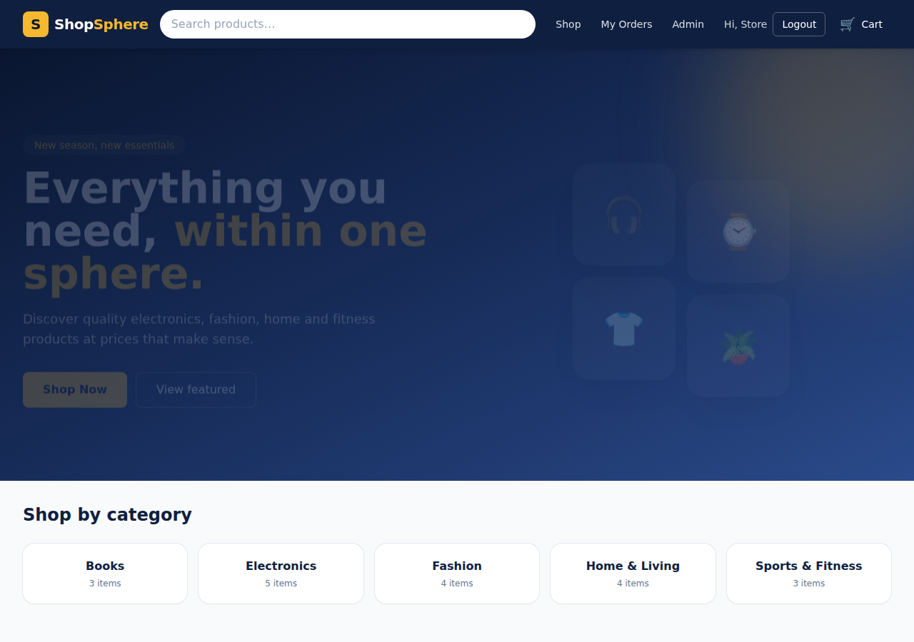
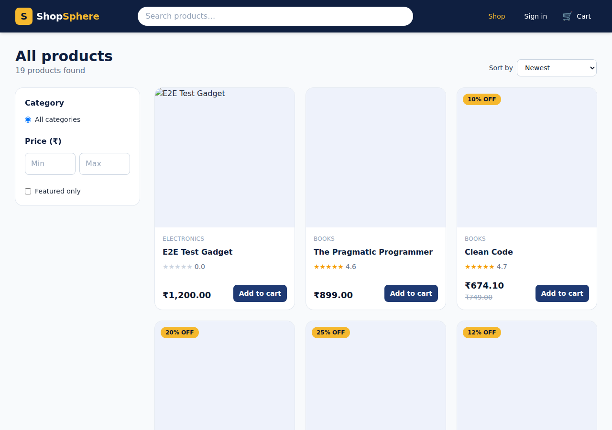
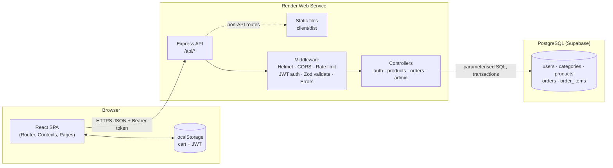
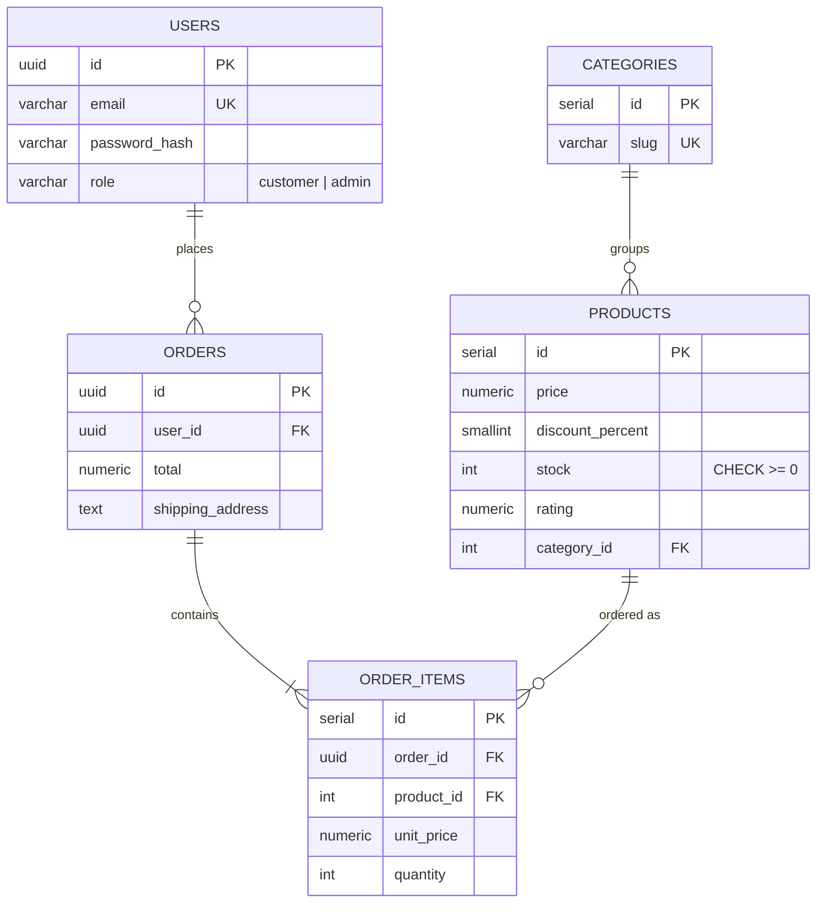
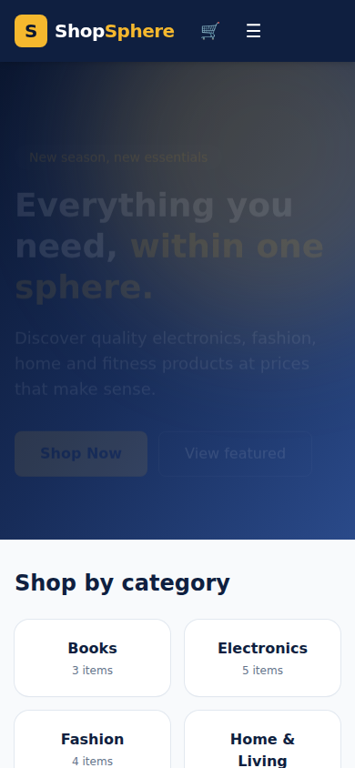

# ShopSphere – Full-Stack E-Commerce Platform

> B.Tech CSE project · *Full-Stack Deployment & Project Architecture*

ShopSphere is a responsive online store built with **React + TypeScript** on the frontend and **Node.js + Express** on the backend, backed by a **PostgreSQL** database (Supabase-compatible). It covers catalogue browsing, search and filtering, a persistent cart, demo checkout with server-side validation, authenticated order history, and a role-protected admin dashboard.

**Live demo:** `https://your-app.onrender.com` *(replace after deployment)*




---

## 1. Problem statement and objectives

Small online retailers need a store that is secure, fast on mobile, and simple to manage. Many student projects stop at a static UI. ShopSphere instead delivers a working vertical slice of a real system.

**Objectives**
- Build a complete, deployable full-stack application rather than a static prototype.
- Enforce security on the server: hashed passwords, JWT authentication, role-based authorization, and input validation.
- Keep prices and stock authoritative on the server so the client cannot tamper with totals.
- Persist users, products, and orders in a relational database with proper constraints.
- Demonstrate clean architecture: routing, services, controllers, middleware, and centralised error handling.

## 2. Features

| Area | Implemented |
|---|---|
| Catalogue | Home with featured products, categories, special offers, benefits section, product listing and detail pages |
| Discovery | Search by name, category filter, price range, featured filter, sorting (newest, price, rating, name), pagination |
| Cart | Add, remove, quantity update (bounded by stock), automatic subtotal, shipping and total; persisted in `localStorage` |
| Checkout | Shipping form with client and server validation, **demo mode** acknowledgement, server-computed totals, transactional stock update |
| Orders | Confirmation page, per-user order history |
| Auth | Register, login, logout, session restore, protected routes, rate-limited auth endpoints |
| Admin | Dashboard stats, product create / edit / delete, all-orders table, enforced on the server |
| UX | Loading states, error messages with retry, empty states, toast notifications, responsive navbar, skip link, focus styles |

**Demo mode:** checkout never collects card details and never charges anything.

## 3. Technology stack

- **Frontend:** React 19, TypeScript, Vite, Tailwind CSS, React Router 6
- **Backend:** Node.js (ES modules), Express 4, Zod (validation), bcryptjs (password hashing), jsonwebtoken, Helmet, express-rate-limit
- **Database:** PostgreSQL 16 (Supabase recommended), accessed via `pg` with parameterised queries and transactions
- **Testing:** Vitest + Testing Library (client unit tests), Node's built-in test runner (API tests), Playwright (end-to-end)
- **Deployment:** Render (Blueprint in `render.yaml`) or any Node host with a PostgreSQL URL

## 4. Folder structure

```
shopsphere/
├── client/                     # React + TypeScript + Vite SPA
│   ├── src/
│   │   ├── components/         # Navbar, Footer, ProductCard, Guards (route protection), ui primitives
│   │   ├── context/            # AuthContext, CartContext, ToastContext
│   │   ├── hooks/              # useAsync (data fetching), useDebounce
│   │   ├── lib/types.ts        # Shared domain types
│   │   ├── pages/              # Home, Products, ProductDetail, Cart, Checkout, OrderConfirmation, Account, Admin, Auth, 404
│   │   ├── services/api.ts     # Typed REST client with centralised error handling
│   │   ├── utils/              # Currency/date formatting, cart math, form validation
│   │   └── __tests__/          # Unit tests
│   └── vite.config.ts          # Dev proxy /api -> :4000
├── server/                     # Express REST API
│   ├── src/
│   │   ├── config/env.js       # Validated environment configuration
│   │   ├── db/                 # pg pool, schema.sql (idempotent migration)
│   │   ├── routes/index.js     # All REST routes, grouped by resource
│   │   ├── controllers/        # auth, product, order, admin logic
│   │   ├── middleware/         # auth (JWT), requireAdmin, validate (Zod), errorHandler
│   │   ├── validators/         # Zod schemas for every input
│   │   ├── utils/AppError.js   # Operational error type
│   │   ├── app.js              # Express app factory (security headers, CORS, limiter)
│   │   └── server.js           # Process entry point, graceful shutdown
│   ├── scripts/migrate.js      # Applies schema
│   ├── scripts/seed.js         # Demo catalogue + admin account
│   └── tests/                  # API integration tests
├── e2e/e2e.py                  # Playwright end-to-end suite
├── docs/screenshots/           # Screenshots used in this README
├── render.yaml                 # Render deployment blueprint
└── README.md
```

## 5. System architecture



## 6. Request flow (frontend → backend)

1. **User action** (e.g. "Place demo order") triggers a handler in a page component.
2. The component calls a typed method in `services/api.ts`, which adds the `Authorization: Bearer <JWT>` header.
3. **Express** applies security middleware, then the route-level chain: `requireAuth` (verifies the JWT and loads the *current* user row) → `requireAdmin` where needed → `validate(schema)` (Zod).
4. The **controller** runs business logic. For checkout it opens a transaction, locks product rows with `FOR UPDATE`, recomputes prices and totals from the database, decrements stock, and commits.
5. The response is JSON. Errors pass through the **centralised error handler**, which maps Zod, Postgres, and operational errors to consistent `{ error: { message, details } }` bodies without leaking stack traces.
6. The client normalises numeric strings from Postgres, updates React state or context, and shows a toast or inline error.

## 7. Database schema and relationships



Constraints enforce data integrity: `CHECK` on stock, price, discount, rating and role; `UNIQUE` on email and category slug; foreign keys with `ON DELETE CASCADE` for order children and `RESTRICT` for products referenced by orders (so order history is never silently lost). The full DDL is in `server/src/db/schema.sql`.

## 8. API endpoints

Base URL: `/api`. Protected endpoints require `Authorization: Bearer <token>`.

| Method | Path | Auth | Description |
|---|---|---|---|
| GET | `/health` | – | Liveness check |
| POST | `/auth/register` | – | Create account `{name, email, password}` → `{token, user}` |
| POST | `/auth/login` | – | Sign in `{email, password}` → `{token, user}` |
| GET | `/auth/me` | User | Current user |
| GET | `/categories` | – | Categories with product counts |
| GET | `/products` | – | List. Query: `search, category, sort, minPrice, maxPrice, featured, page, limit` |
| GET | `/products/:id` | – | Product detail with computed `final_price` |
| POST | `/orders` | User | Demo checkout `{items:[{productId, quantity}], shipping:{…}, demoAcknowledged: true}` |
| GET | `/orders/mine` | User | Own order history |
| GET | `/orders/mine/:id` | User | One of own orders (404 if not owned) |
| GET | `/admin/stats` | Admin | Dashboard counts and revenue |
| GET | `/admin/orders` | Admin | All orders |
| POST | `/admin/products` | Admin | Create product |
| PATCH | `/admin/products/:id` | Admin | Update product fields |
| DELETE | `/admin/products/:id` | Admin | Delete product (409 if referenced by orders) |

**Error format:** `{ "error": { "message": "…", "details": [{ "field": "…", "message": "…" }] } }`

## 9. Local setup

**Prerequisites:** Node.js 18+ (20+ recommended), npm, PostgreSQL 14+ (or a Supabase project).

```bash
git clone https://github.com/<your-user>/shopsphere.git
cd shopsphere
npm run install:all

# 1. Configure secrets
cp server/.env.example server/.env          # then edit values
cp client/.env.example client/.env          # usually left empty in development

# 2. Create schema and seed demo data
npm run db:migrate
npm run db:seed

# 3. Run both apps (two terminals)
npm run dev:server     # API on http://localhost:4000
npm run dev:client     # UI on  http://localhost:5173
```

Open http://localhost:5173. Sign in as the seeded admin using `ADMIN_EMAIL` / `ADMIN_PASSWORD` from your `.env`.

## 10. Environment variables

All values live in `server/.env` (never committed). The complete template is `server/.env.example`.

| Variable | Required | Purpose |
|---|---|---|
| `DATABASE_URL` | ✔ | PostgreSQL connection string |
| `DATABASE_SSL` | | `true` for Supabase/Render-hosted databases |
| `JWT_SECRET` | ✔ | Signing key, ≥ 32 characters. Generate with `node -e "console.log(require('crypto').randomBytes(48).toString('hex'))"` |
| `JWT_EXPIRES_IN` | | Token lifetime, default `7d` |
| `CLIENT_ORIGIN` | | Comma-separated allowed origins for CORS |
| `PORT` | | API port, default `4000` |
| `NODE_ENV` | | `production` enables serving the built client |
| `ADMIN_EMAIL` / `ADMIN_PASSWORD` | | Used only by the seed script to create the admin |

Server startup fails fast if required variables are missing or too weak.

## 11. Database setup and migrations

- **Migration:** `npm run db:migrate` applies `server/src/db/schema.sql`. It is idempotent (`IF NOT EXISTS`), so it is safe to re-run.
- **Seed:** `npm run db:seed` inserts categories, 18 sample products, and the admin account. Products are inserted only if the table is empty.
- **Supabase:** create a project, open *Project Settings → Database*, copy the **Session pooler** URI, and set it as `DATABASE_URL` with `DATABASE_SSL=true`.

## 12. Build and testing

```bash
npm run build                       # production build of the client (tsc + vite)
npm test --prefix client            # Vitest unit tests (cart math, pricing, validation)
npm test --prefix server            # API integration tests (start the server first)
python3 e2e/e2e.py                  # Playwright end-to-end run (needs app on :4000 in production mode)
```

Coverage highlights: cart totals and free-shipping threshold, discount rounding, quantity limits, checkout validation, auth-protected and admin-only routes, validation error shapes, the full register → checkout → order history → admin product creation journey.

## 13. GitHub setup

```bash
git init
git add .
git commit -m "feat: ShopSphere full-stack e-commerce"
git branch -M main
git remote add origin https://github.com/<your-user>/shopsphere.git
git push -u origin main
```

`.gitignore` already excludes `node_modules`, `dist`, and every `.env` file except `.env.example`.

## 14. Deployment guide (Render + Supabase)

1. **Database:** create a Supabase project and copy the Session pooler connection string.
2. **Push** the repository to GitHub (section 13).
3. **Create the service:** on Render, choose *New → Blueprint*, select the repository, and Render reads `render.yaml`.
4. **Set secrets** in the Render dashboard: `DATABASE_URL`, `CLIENT_ORIGIN` (your Render URL), `ADMIN_EMAIL`, `ADMIN_PASSWORD`. `JWT_SECRET` is generated automatically.
5. **Build:** Render runs `npm ci` for both apps, builds the client, and applies the migration.
6. **Seed once:** open the Render *Shell* and run `npm run db:seed --prefix server`.
7. **HTTPS:** Render provides a public `https://<name>.onrender.com` URL automatically. Put that URL in `CLIENT_ORIGIN`.
8. Update the *Live demo* link at the top of this README.

**Alternative split deployment:** host `client/` on Vercel or Netlify with `VITE_API_URL=https://<api-host>/api`, and host `server/` on Render. Add the frontend origin to `CLIENT_ORIGIN`.

## 15. Security notes

- Passwords are hashed with bcrypt (cost 12). Hashes are never returned by the API.
- JWTs are verified with an explicit algorithm allow-list. The user row is reloaded on each request, so deleted users lose access immediately.
- Admin authorization is enforced by middleware on the server. Hiding UI is not treated as security.
- All SQL uses parameterised queries. Search input escapes `%` and `_`.
- Prices, totals and stock are computed on the server. Client-provided prices are ignored.
- Helmet sets security headers and a Content-Security-Policy. Auth endpoints are rate-limited.
- No real payment data is collected. Checkout is clearly labelled as demo mode.

## 16. Screenshots

| Home | Products | Mobile |
|---|---|---|
|  |  |  |

## 17. Limitations and future work

- Product images use placeholder URLs; replace them with your own media storage (Supabase Storage, Cloudinary).
- Demo checkout does not integrate a payment gateway (Razorpay / Stripe) by design.
- Refresh tokens and password reset are not implemented.
- The admin dashboard has no product image upload yet.

## License

Academic use. Add a license file before publishing publicly.
"# ShopSphere" 
